# QuickLoan -- Highly Available Loan Application Deployment on AWS

A cloud deployment project that hosts a loan application on AWS using a highly available, scalable architecture. The project demonstrates AWS networking, compute, storage, database, load balancing, auto scaling, DNS, monitoring, and notifications.

## Project Overview

QuickLoan is a sample loan application where users can submit loan details through a web form. Application data is stored in an Amazon RDS MySQL database. The deployment uses an Application Load Balancer and an Auto Scaling Group to support availability and scaling across Availability Zones.

**Application URL used in the project:** http://loan.pranavtatar.in

> This URL is included as documented in the project material. Its current availability is not guaranteed.

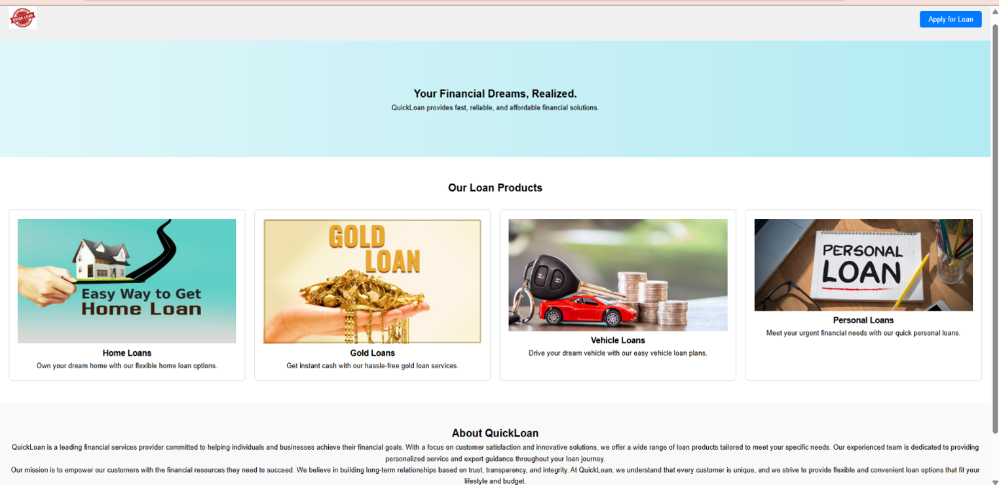

## AWS Services Used

| Area | AWS Services / Components |
|------|---------------------------|
| Networking | Amazon VPC, public and private subnets, route tables, Internet Gateway, NAT Gateway, security groups, Availability Zones |
| Compute | Amazon EC2, Amazon Machine Images (AMI), launch templates, Auto Scaling Group |
| Storage | Amazon S3 |
| Database | Amazon RDS for MySQL |
| High availability | Application Load Balancer (ALB), target groups |
| Monitoring and notifications | Amazon CloudWatch, Amazon SNS |
| DNS | Amazon Route 53, with domain nameservers managed through GoDaddy |

## Architecture and Workflow

1. Configure the VPC and networking components, including subnets, gateways, and route tables.
2. Configure security groups to control traffic to the application and supporting resources.
3. Launch EC2 instances and deploy the website files.
4. Create an S3 bucket for project storage.
5. Configure the domain in Route 53 and point the GoDaddy nameservers to Route 53.
6. Create an Amazon RDS MySQL database and connect it to the application.
7. Create an AMI from the configured application instance.
8. Configure a launch template and an EC2 target group.
9. Create an Application Load Balancer to distribute incoming application traffic.
10. Create an SNS topic and email subscription for notifications.
11. Create an Auto Scaling Group using the launch template.
12. Configure CloudWatch alarms and dynamic scaling policies.

## Deployment Screenshots

### 1. Application

**Loan application form**

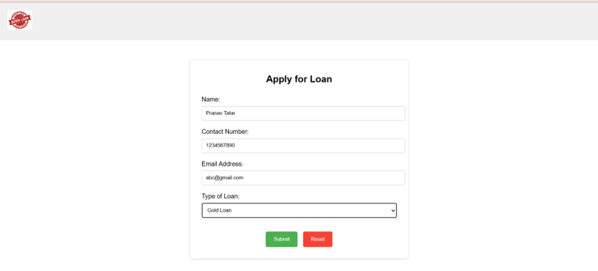

### 2. Networking

**VPC creation**

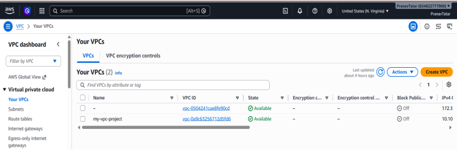

**Subnet configuration**

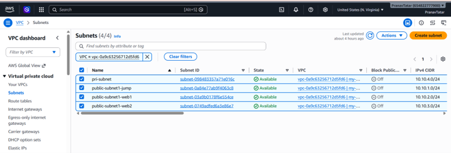

**Internet Gateway**

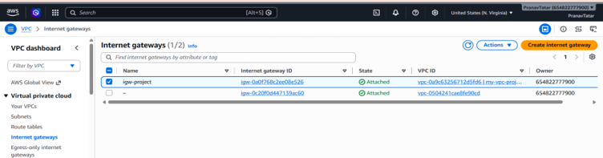

**NAT Gateway**

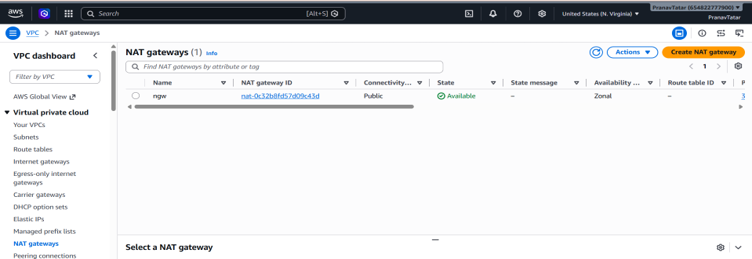

**Route table configuration**

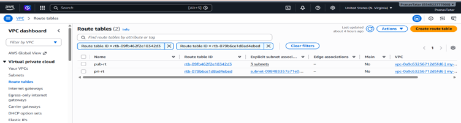

**Security groups**

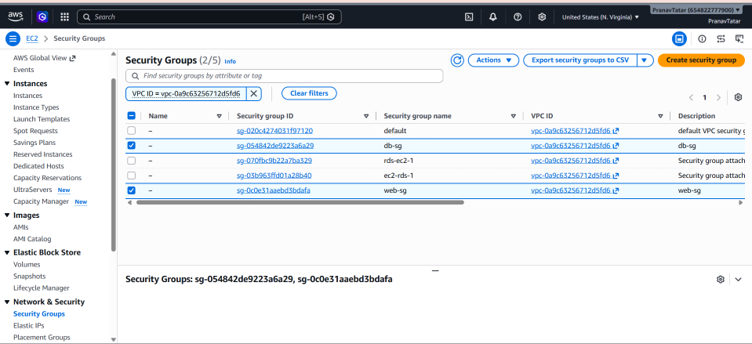

### 3. Compute and Storage

**EC2 instances**

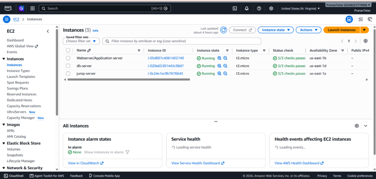

**Website files upload**

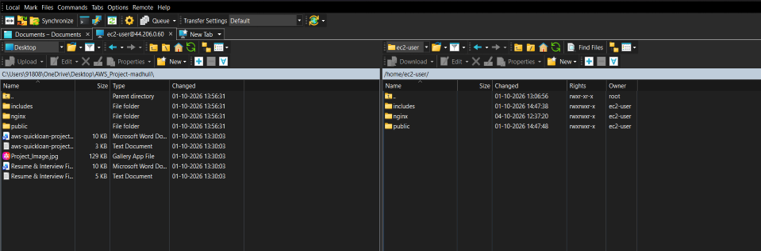

**S3 bucket**

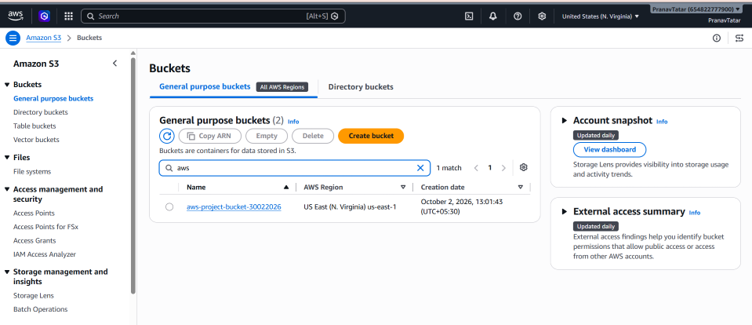

### 4. DNS

**Route 53 hosted zone records**

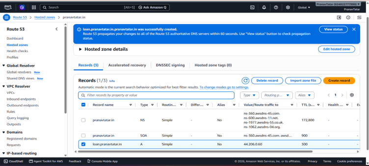

**GoDaddy nameservers**

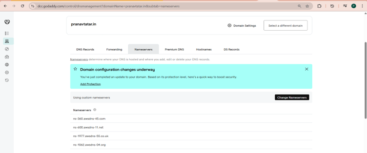

### 5. Database

**RDS MySQL database**

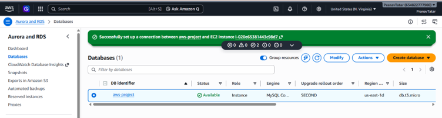

**Application and database test**

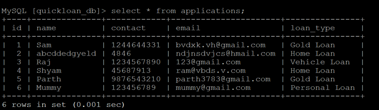

### 6. High Availability

**AMI creation**

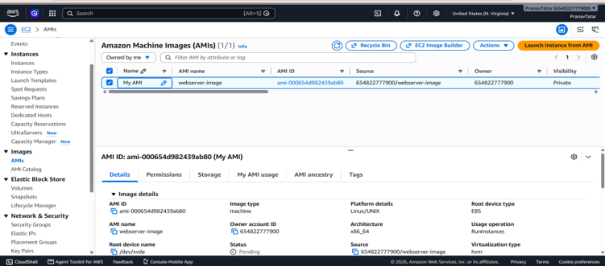

**Launch template**

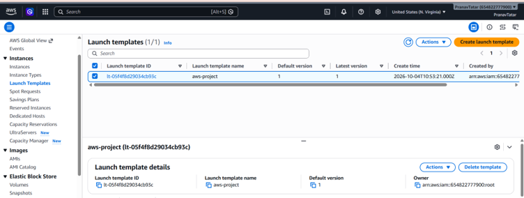

**Target group**

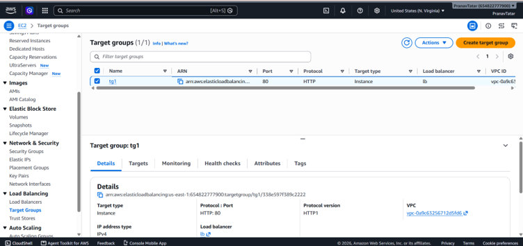

**Application Load Balancer**

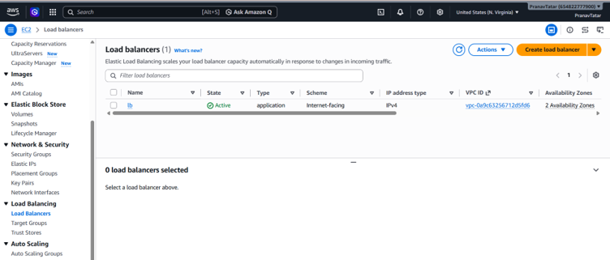

### 7. Notifications

**SNS topic**

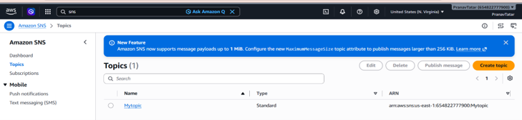

**SNS email subscription**

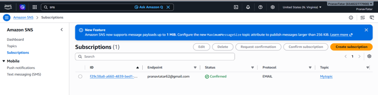

### 8. Auto Scaling and Monitoring

**Auto Scaling Group**

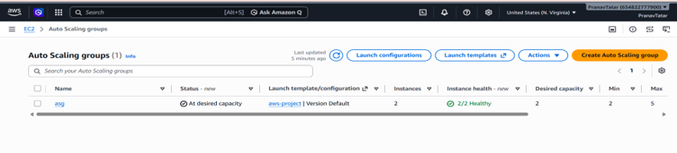

**CloudWatch alarms**

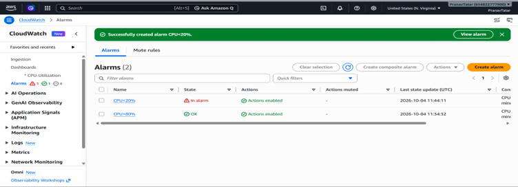

**Dynamic scaling policies**

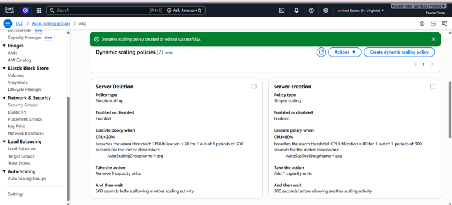

## Application Testing

A loan application was submitted through the web form, and the submitted records were checked in the RDS MySQL database.

Example SQL query used for verification:

```sql
SELECT * FROM applications;
```

The output shows application records with fields for ID, name, contact, email, and loan type.

## Monitoring and Auto Scaling

CloudWatch alarms monitor EC2 CPU utilization:

- **CPU > 80%** -- high CPU utilization alarm.
- **CPU < 20%** -- low CPU utilization alarm.

Dynamic scaling policies adjust the number of EC2 instances based on CPU utilization. Amazon SNS sends email notifications.

## Repository Structure

```text
QuickLoan-AWS/
├── README.md
└── screenshots/
    ├── 01-application-homepage.png
    ├── 02-loan-application-form.png
    └── ... (24 screenshots)
```

## Prerequisites

- An AWS account with permission to create the services listed above
- A registered domain name (this project used GoDaddy)
- Application website files
- Basic familiarity with AWS networking, EC2, RDS, load balancing, and Auto Scaling

## Security Notes

- Do not upload AWS access keys, passwords, private keys, database credentials, or other secrets to GitHub.
- Do not commit `.pem` files, environment files containing secrets, or database dumps with personal information.
- Use IAM roles and appropriately scoped security groups rather than embedding credentials in application files.
- Review AWS resources and remove anything no longer needed to avoid unexpected charges.

## Learning Outcomes

- Building a VPC-based AWS network with public and private subnets
- Deploying a web application on EC2
- Connecting an application to an RDS MySQL database
- Configuring an Application Load Balancer and target group
- Creating an AMI and launch template
- Configuring an Auto Scaling Group and dynamic scaling policies
- Monitoring EC2 metrics with CloudWatch and sending notifications through SNS
- Managing DNS using Route 53 and GoDaddy

## Author

**Pranav Tatar**
